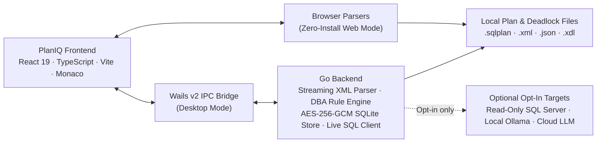

# PlanIQ ⚡
### Modern SQL Server & PostgreSQL Execution Plan Visualizer, Root-Cause Diagnostics & AI Advisor

[](https://github.com/imrulhasan273/PlanIQ/actions/workflows/ci.yml)
[](https://github.com/imrulhasan273/PlanIQ/releases)
[](https://github.com/imrulhasan273/PlanIQ/releases)
[](https://golang.org)
[](https://react.dev)
[](https://www.typescriptlang.org/)
[](https://wails.io/)
[](https://www.microsoft.com/sql-server)
[-336791?style=flat&logo=postgresql)](https://www.postgresql.org/)
[](LICENSE)

**PlanIQ** is a cross-platform, offline-first execution plan visualizer, root-cause diagnostic engine, and AI-powered query tuning copilot for **Microsoft SQL Server** (`.sqlplan` / `.xml` / `.xdl`) and **PostgreSQL** (`EXPLAIN (ANALYZE, BUFFERS, FORMAT JSON)` `.json`).

While traditional tools like SQL Server Management Studio (SSMS) simply render raw operator trees and leave interpretation to manual effort, **PlanIQ decodes execution plans in seconds**—calculating health scores, isolating dominant bottlenecks, consolidating fragmented index hints, and generating production-ready query rewrites.

> **Contents:** [Highlights](#-highlights) · [PlanIQ vs. SSMS](#-planiq-vs-ssms-execution-plan) · [Architecture](#-architecture) · [Installation & Quick Start](#-getting-started) · [Using PlanIQ](#-using-planiq) · [Security & Privacy](#-security-privacy--offline-transparency) · [Repository Layout](#-repository-layout) · [Contributing](#-contributing)

---

## ⚡ Highlights

- **🎯 10-Second Culprit Isolation:** Instantly pinpoints the dominant bottleneck statement in multi-query batches (e.g., Stmt #4 accounting for 54.2% of batch cost).
- **🏆 Plan Health Score (0–100, Grade A–F):** Holistic query grading factoring compilation overhead, memory spills, non-sargability, and CE version.
- **🔬 Deep Root-Cause Diagnostic Engine:**
  - **Memory Grant & TempDB Spills:** Flags sort/hash operations spilling to disk.
  - **Cardinality Estimator Model:** Detects legacy SQL 7.0 CE (`CEVersion="70"`) vs. modern CE regression risks.
  - **Non-Sargable Implicit Conversions:** Identifies `CONVERT_IMPLICIT` warnings on join/filter predicates preventing index seeks.
  - **Scalar UDF (RBAR) Penalty:** Highlights row-by-agonizing-row scalar functions executing in relational pipelines.
  - **Parallelism Skew:** Identifies thread workload imbalances and single-threaded MaxDOP bottlenecks.
- **🔒 Deadlock Graph Viewer (.xdl & PG Logs):** 100% offline interactive SQL Server deadlock visualizer (including **SQL Server 2025 Optimized Locking** `<tidlock>` / `XACT` transaction locks) and PostgreSQL deadlock log parser. Highlights directed wait-for cycles, marks killed victim SPIDs, parses full `inputbuf` queries, displays execution call stacks, and prescribes T-SQL error 1205 retry patterns.
- **🎛️ Parameter Sniffing & Runtime Variable Inspector:** Detects divergence between `<ParameterList>` Compiled (cached) and Runtime (executed) values, evaluates cardinality estimate skew, and provides 4 ready-to-copy T-SQL remedies (`OPTION (RECOMPILE)`, `OPTIMIZE FOR UNKNOWN`, value pinning, local variable masking).
- **⚡ Intelligent Query Processing (SQL 2017–2025 IQP):** Analyzes Adaptive Joins, Batch Mode on Rowstore, Memory Grant Feedback, DOP Feedback, and **SQL Server 2025 (Compat Level 170)** features—**Optional Parameter Plan Optimization (OPPO)**, **CE Feedback for Expressions**, **DiskANN Vector Search** (`VECTOR_SEARCH` vs. `VECTOR_DISTANCE`), and **RegEx / JSON Index** sargability.
- **📸 High-Res Export (PNG / SVG & Offline HTML Sharing):** Export plan trees to High-Res PNG or vector SVG with a single click, or generate a standalone, XSS-escaped interactive HTML diagnostic report that opens in any browser on air-gapped corporate networks without dependencies.
- **⏱️ Batch Flow & TempDB Lifecycle Visualizer:** Sequential statement execution waterfall, cumulative subtree cost progression tracker, `#temp` table lifecycle matrix (Creation &rarr; Ingestion &rarr; Reads &rarr; Indexes &rarr; Drops), and TempDB worktable disk spill alerts.
- **⏳ Wait Statistics & Resource Bottlenecks Deep-Dive:** Comprehensive physical wait event analyzer (Disk I/O, Parallelism, Memory Grants, Schedulers) with category distribution bars, ranked wait events, operator correlations, and built-in DBA reference handbook.
- **📚 SQL Server & PostgreSQL Tuning Playbook:** Interactive encyclopedia of engine anti-patterns with before-and-after SQL comparisons, relational join physics deep-dive, query hints guide, and plan-aware detection.
- **🧩 Smart Missing Index Consolidator:** Deduplicates and merges overlapping equality, inequality, and include columns into clean composite covering indexes.
- **🤖 Deterministic DBA Engine & AI Query Rewriter:** Generates production-ready SQL rewrites with an interactive locally-bundled **Monaco Side-by-Side Diff Viewer**.
- **⚖️ Side-by-Side Plan Comparator:** Compare baseline and optimized `.sqlplan` or PostgreSQL `.json` files with cost reduction diffs and missing index resolution metrics.
- **🐘 PostgreSQL EXPLAIN JSON Support (PostgreSQL 12 – 19):** Dedicated engine switcher dropdown with interactive tree visualization, shared/temp buffer hit/read/spill block metrics, parallel worker planned vs. launched tracking, **PG 17–19 `EXPLAIN (SERIALIZE, MEMORY, WAL)`**, **PG 18 B-Tree Index Skip Scan (`Index Searches`)**, granular Asynchronous I/O timings, `Memoize` cache hit/eviction analysis, `pgvector` HNSW/IVFFlat detection, and **PostgreSQL 19 `REPACK (CONCURRENTLY)`** online bloat remediation.
- **📡 Live Radar & Query Store Studio (Optional SQL Server & PostgreSQL Mode):** Read-only DPA-style wait trend charts, active/blocking session trees (`sys.dm_exec_requests` / `pg_stat_activity` & `pg_locks`), buffer pool & PLE monitoring, TempDB/`pgsql_tmp` usage inspection, Query Store / `pg_stat_statements` top-query analysis, and AES-256-GCM encrypted SQLite connection profiles (`planiq_config.db`).
- **🔒 Offline-First & Private by Design:** All plan/deadlock parsing, root-cause diagnostics, deterministic tuning rules, and HTML/PNG/SVG report exports run locally with zero database connection required; Live Radar and cloud LLM providers are strictly opt-in.

---

## 📊 PlanIQ vs. SSMS Execution Plan

| Feature / Capability | SSMS Execution Plan | PlanIQ |
| :--- | :---: | :---: |
| **Graphical Execution Plan** | ✅ Native GDI+ | ✅ Modern Responsive Canvas |
| **Multi-Statement Batch Navigation** | ⚠️ Long horizontal scroll | ✅ Isolated statement cards + cost % |
| **Batch Waterfall & TempDB Lifecycle** | ❌ None | ✅ Interactive Waterfall & `#temp` Matrix |
| **Wait Statistics Analysis** | ⚠️ Buried in properties XML | ✅ Categorized Bar, Table & Remediation |
| **Built-in Tuning Playbook & Code Diff** | ❌ None | ✅ Interactive Patterns with Before/After SQL |
| **Automated Culprit Identification** | ❌ Manual DBA inspection | ✅ Instant 10-second isolation |
| **Plan Health Score & Grade** | ❌ None | ✅ 0–100 Health Score (Grade A–F) |
| **Legacy CE (CE 70) Detector** | ❌ Buried in XML attributes | ✅ Dedicated diagnostic alert card |
| **Non-Sargable `CONVERT_IMPLICIT` Detector** | ❌ Hidden in operator tooltip | ✅ Visual sargability warning badge |
| **Scalar UDF (RBAR) Penalty Alert** | ❌ None | ✅ Direct UDF execution warning |
| **Missing Index Handling** | ⚠️ Isolated green text per query | ✅ Smart Consolidator & Deduplicator |
| **Automated Query Rewriting** | ❌ None | ✅ Deterministic DBA Engine + AI Diff |
| **Interactive SQL Diff View** | ❌ None | ✅ Side-by-side Monaco Diff Viewer |
| **Deadlock Graph Viewer (.xdl / PG)** | ⚠️ Basic static boxes | ✅ Interactive Directed Cycle Graph + Stack |
| **Parameter Sniffing Inspector** | ⚠️ Buried in XML list | ✅ Compiled vs Runtime Diff + 4 T-SQL Fixes |
| **Adaptive Joins & Batch Mode (IQP)** | ❌ Hidden in operator | ✅ Inflection Cutoff & Vectorization Analysis |
| **High-Res Export (PNG/SVG/HTML)** | ❌ Fragmented screenshots | ✅ 1-Click PNG, SVG & Offline HTML Report |
| **Cross-Platform / Zero-Install** | ❌ Windows-only (~4GB install) | ✅ Windows, macOS, Linux & Browser |
| **Database Connection Required** | ✅ Yes (to capture plans) | ❌ No (100% offline analysis) |

---

## 🏗️ Architecture



- **Frontend (React 19 + TypeScript + Vite):** Renders the interactive plan canvas, charts, and locally-bundled Monaco side-by-side diff viewer, with client-side parsers for both SQL Server ShowPlan XML and PostgreSQL `EXPLAIN (FORMAT JSON)`.
- **Backend (Go + Wails):** Uses standard library streaming XML tokenizers to parse massive multi-megabyte `.sqlplan` files in milliseconds, persists encrypted connection profiles in SQLite (`modernc.org/sqlite`), and supports optional read-only SQL Server connections (`go-mssqldb`).
- **Tuning Advisor:** Combines a local deterministic DBA heuristic rule engine with optional LLM support (local **Ollama** at `http://localhost:11434`, or opt-in cloud **Google Gemini** / **OpenAI**).

---

## 🚀 Getting Started

### Option 1: Download Pre-Built Desktop Binaries (Fastest)

Download the latest release for your OS from the [GitHub Releases](https://github.com/imrulhasan273/PlanIQ/releases) page:

| Platform | Package | Notes |
| :--- | :--- | :--- |
| **Windows (x64)** | `PlanIQ-vX.Y.Z-windows-amd64.zip` | Extract and run `PlanIQ.exe` (uses built-in Edge WebView2). |
| **macOS (Apple Silicon & Intel)** | `PlanIQ-vX.Y.Z-darwin-universal.zip` | Extract `PlanIQ.app` to `/Applications`. If Gatekeeper blocks an unsigned build, run `xattr -cr /Applications/PlanIQ.app` once. |
| **Linux (x64)** | `PlanIQ-vX.Y.Z-linux-amd64.tar.gz` | Requires `libgtk-3-0` & `libwebkit2gtk-4.1-0` (Ubuntu 24.04+). Extract with `tar -xzf PlanIQ-*.tar.gz && ./PlanIQ`. |

Verify artifact integrity with the release `SHA256SUMS.txt`:
```bash
sha256sum -c SHA256SUMS.txt --ignore-missing
# On macOS:
shasum -a 256 -c SHA256SUMS.txt --ignore-missing
```

---

### Option 2: Run in Browser (Zero-Install Web Mode)

1. Clone the repository:
   ```bash
   git clone https://github.com/imrulhasan273/PlanIQ.git
   cd PlanIQ/frontend
   ```
2. Install dependencies & start the dev server:
   ```bash
   npm install
   npm run dev
   ```
3. Open `http://localhost:5173/` in your browser. Drag and drop any `.sqlplan`, `.xml`, `.json`, or `.xdl` file to start analyzing.

> **GitHub Pages Ready:** A workflow ([pages.yml](.github/workflows/pages.yml)) is included—enable **Settings → Pages → Source: GitHub Actions** to publish your own static browser edition automatically.

---

### Option 3: Build Native Desktop App from Source (Wails v2)

#### Prerequisites
- [Go 1.26+](https://golang.org/dl/)
- [Node.js 22+](https://nodejs.org/)
- [Wails CLI v2](https://wails.io/docs/gettingstarted/installation):
  ```bash
  go install github.com/wailsapp/wails/v2/cmd/wails@latest
  ```
- **Linux (Ubuntu 24.04+) desktop libraries:**
  ```bash
  sudo apt-get update && sudo apt-get install -y build-essential pkg-config libgtk-3-dev libwebkit2gtk-4.1-dev
  ```

#### Live Development
```bash
wails dev
# On Ubuntu 24.04+ / WebKit2GTK 4.1:
wails dev -tags webkit2_41
```

#### Build Production Binary
```bash
# Windows / macOS:
wails build -clean

# macOS Universal (Apple Silicon + Intel):
wails build -clean -platform darwin/universal

# Linux (Ubuntu 24.04+ / WebKit2GTK 4.1):
wails build -clean -tags webkit2_41
```
The compiled binary or `.app` bundle will be placed in `build/bin/`.

---

## 🧭 Using PlanIQ

### 1. Loading an Execution Plan
- Select **SQL Server** or **PostgreSQL** via the top engine switcher dropdown (or reset back to the welcome screen anytime).
- Click **Open File** to select a SQL Server `.sqlplan`/`.xml` file, a PostgreSQL `EXPLAIN (ANALYZE, BUFFERS, FORMAT JSON)` `.json` file, or a `.xdl` deadlock graph—or drag and drop directly onto the app.
- Or click **Paste ShowPlan XML** / **Paste EXPLAIN (JSON)** to paste execution plans directly from your clipboard.

### 2. Overview & Diagnostics
- Review the **Plan Health Score** and grade.
- Check the **Top Bottleneck Statement** to see which query dominates resource consumption.
- Read through **Advanced Root Causes** (spills, CE version, sargability, UDF penalties).

### 3. Missing Indexes Tab
- Review consolidated index recommendations.
- Click **Copy DDL** to copy production-ready `CREATE INDEX` scripts.

### 4. AI Advisor Tab
- Click **Run AI Advisory Analysis** to trigger the Deterministic DBA Rule Engine.
- Inspect the optimized query in the **Side-by-Side Monaco Diff Viewer** with highlighted structural improvements.

### 5. Deadlock Graph (.xdl / PostgreSQL Logs) Visualizer
- Click **Deadlocks (.xdl)** in the top navigation bar.
- Open any `.xdl` file exported from SSMS, Extended Events, or PostgreSQL error logs (or drag and drop into the app).
- Inspect the directed lock-cycle graph, chronological timeline, side-by-side session diff, lock granularity matrix, remediation scripts, and export to PNG/SVG.

### 6. Live Radar & Wait Trend (Optional SQL Server Mode)
- Connect safely to your live SQL Server instance with read-only intent (`READ UNCOMMITTED`, `LOCK_TIMEOUT 3000ms`).
- Inspect wait category trends, automated performance advisors, live deadlocks from `system_health`, Query Store regressions, and buffer pool / PLE health.

---

## 🛡️ Security, Privacy & Offline Transparency

PlanIQ is engineered as an **offline-first** diagnostic workbench:

- **100% Local Analysis:** Execution plan parsing, deadlock graphing, root-cause diagnostics, deterministic query rewrites, and XSS-escaped HTML/PNG/SVG exports run locally with zero external network calls or CDN requests.
- **Encrypted Local Storage:** Optional saved database connection profiles are stored in SQLite (`planiq_config.db`, `0600`) inside a user-only config directory (`0700`) with passwords encrypted via **AES-256-GCM**.
- **Strictly Opt-In Network Features:** Live SQL Server connections (`ApplicationIntent=ReadOnly`, `READ UNCOMMITTED`) and cloud LLM providers (Gemini/OpenAI with built-in SQL literal sanitization) are only active when explicitly configured by the user.

See [SECURITY.md](SECURITY.md) for the full threat model and vulnerability disclosure process.

---

## 📂 Repository Layout

```text
PlanIQ/
├── .github/workflows/       # CI (Go race/vulncheck + frontend tests), Releases (Win/macOS/Linux + SHA256), Pages
├── main.go & app.go         # Wails v2 desktop entry point & IPC bindings
├── pkg/
│   ├── sqlplan/             # Streaming ShowPlan XML parser, diagnostics & time attribution
│   ├── advisor/             # Deterministic DBA rule engine, SQL sanitizer & optional LLM client
│   ├── configdb/            # AES-256-GCM encrypted SQLite profile & settings store
│   └── livedb/              # Modular read-only live SQL Server telemetry (client, sessions, querystore, waits, internals)
└── frontend/
    └── src/
        ├── components/      # Plan canvas, Deadlock viewer, Live Radar, Playbook & PostgreSQL views
        ├── data/            # Structured SQL Server & PostgreSQL reference data
        ├── types/           # TypeScript domain contracts
        └── utils/           # ShowPlan/PG/Deadlock parsers, XSS-safe report exporter & unit tests
```

---

## 🤝 Contributing

Contributions, issues, and feature requests are welcome! Please read [CONTRIBUTING.md](CONTRIBUTING.md) and our [Code of Conduct](CODE_OF_CONDUCT.md) before opening a pull request.

1. Fork the repository
2. Create your feature branch (`git checkout -b feat/amazing-feature`)
3. Run checks: `go vet ./pkg/... && go test -race -v ./pkg/...` and `npm --prefix frontend test && npm --prefix frontend run build`
4. Commit your changes (`git commit -m "feat: add amazing feature"`)
5. Push to the branch (`git push origin feat/amazing-feature`)
6. Open a Pull Request

---

## 📄 License

Distributed under the MIT License. See [LICENSE](LICENSE) for more information.
